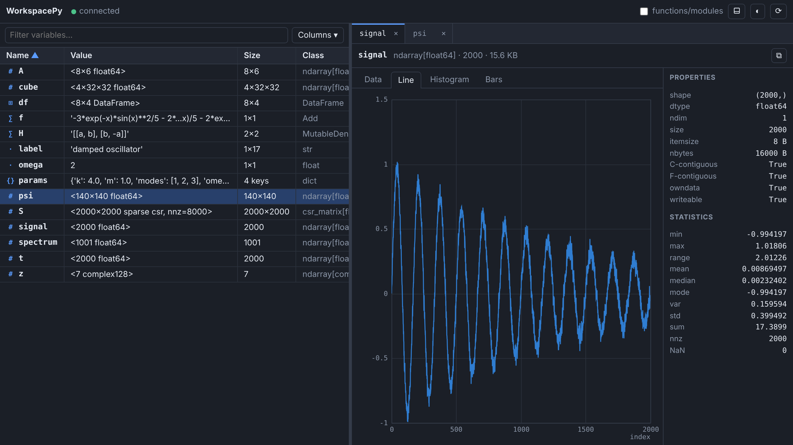
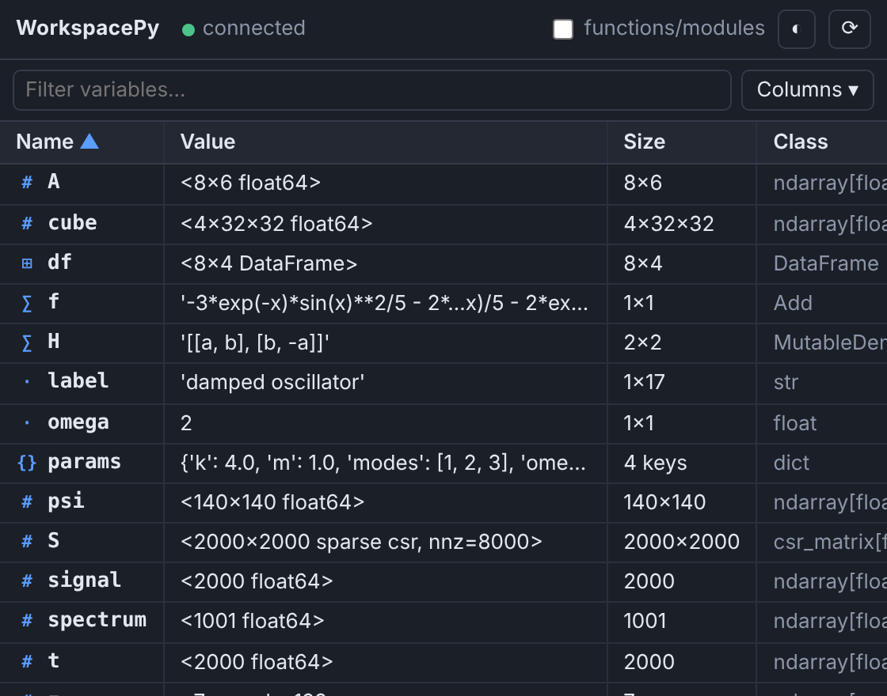
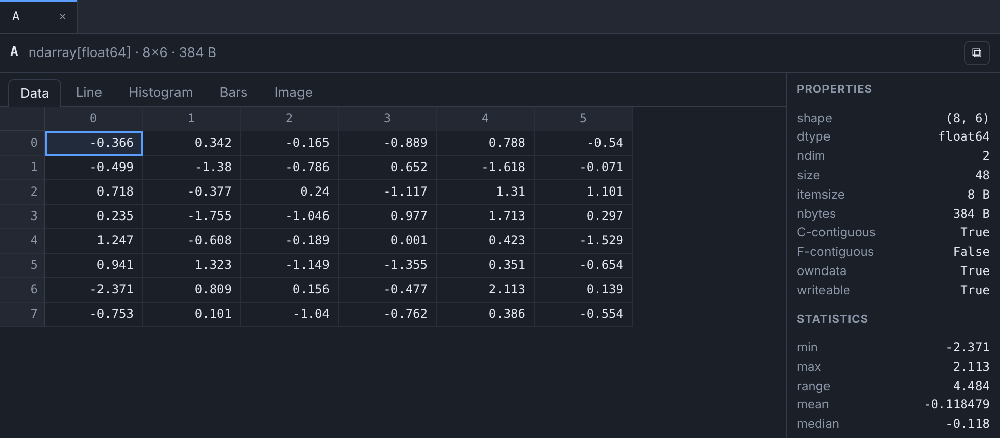
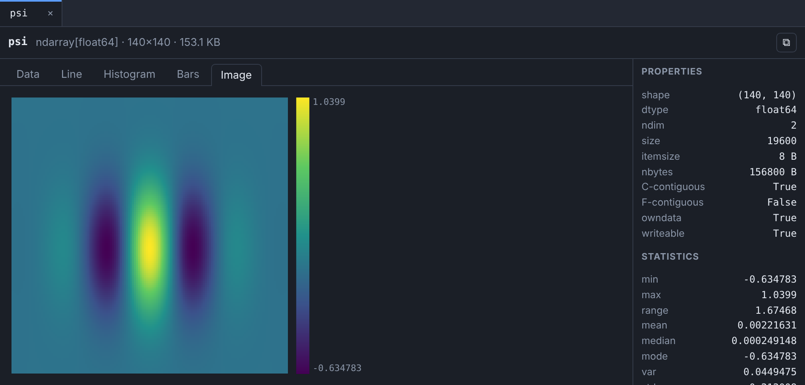
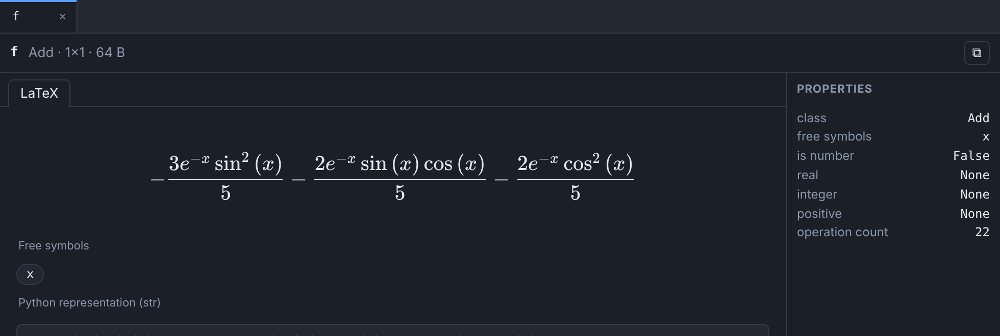
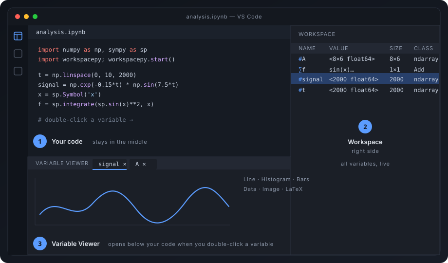

<div align="center">


# WorkspacePy

**The MATLAB workspace you miss, for Python.**<br>
Live variables, one-click statistics, spreadsheet-style array editing and plots — right next to your notebook.

<p>
  
  
  
  
</p>

<p>
  <a href="#-quick-start">Quick start</a> ·
  <a href="#-the-matlab-layout-in-vs-code">VS Code layout</a> ·
  <a href="#-what-you-can-do">Features</a> ·
  <a href="#-updating">Updating</a> ·
  <a href="#-extend-it">Extend it</a>
</p>



</div>

---

## ✨ What you can do

Open a notebook, call `workspacepy.start()`, and every variable you create shows up in a live table — exactly like the MATLAB Workspace. **Double-click** anything to open it, and keep as many objects open as you want.

<table>
<tr>
<td width="50%" valign="top">

### 📋 A real workspace
`Name · Value · Size · Class` by default, and **right-click the header** to add `Bytes`, `Min`, `Max`, `Range`, `Mean`, `Median`, `Mode`, `Std`, `Var`, `Sum`, `Nnz`, `NaN` — the same statistics columns MATLAB offers. Sort, filter, delete, refresh automatically after every cell.

</td>
<td width="50%" valign="top">



</td>
</tr>
<tr>
<td width="50%" valign="top">



</td>
<td width="50%" valign="top">

### 🧮 Variable Editor for arrays
Spreadsheet-style grid that stays fast on **huge arrays** (only visible cells are fetched). **Edit cells** in place (double-click, <kbd>Enter</kbd>, or just type), move with the arrow keys, slice **N-d arrays** with `[i, j, :, :]` selectors. Complex numbers, booleans, NaN/Inf all handled.

</td>
</tr>
<tr>
<td width="50%" valign="top">

### 📈 Plots without writing plot code
**Line**, **Histogram**, **Bars** and **Image** tabs for any numeric array — large signals are decimated while keeping the peaks. Statistics (`min`, `max`, `range`, `mean`, `median`, `mode`, `std`, …) sit in the side panel, ignoring NaNs and following MATLAB conventions (`std` with N−1).

</td>
<td width="50%" valign="top">



</td>
</tr>
<tr>
<td width="50%" valign="top">



</td>
<td width="50%" valign="top">

### ∑ SymPy, SciPy, pandas — natively
SymPy expressions and matrices render as **LaTeX** (KaTeX is bundled, so it works offline). SciPy **sparse** matrices show format, `nnz` and density. pandas **DataFrames** get labelled, editable grids plus a per-column summary. Lists, dicts and objects are browsable: double-click an element to open it.

</td>
</tr>
</table>

### Supported types

| Kind | What you get |
|---|---|
| `numpy.ndarray` (any dtype/ndim) and NumPy scalars | grid, editing, slices, stats, line / histogram / bars / image |
| `scipy.sparse` matrices | grid, `nnz`, density, stats, plots (when small enough to densify) |
| `sympy` expressions & matrices | LaTeX, free symbols, numeric value, matrix grid |
| `pandas` DataFrame / Series / Index | labelled grid, editing, per-column summary, column drill-down |
| `int` `float` `complex` `str` `None` | value view, assign a new value from a Python literal |
| `list` `tuple` `set` `dict` | browsable children, numeric lists also as a grid |
| functions, classes, modules | signature and docstring |
| any other object | its public attributes as browsable children |

---

## 🚀 Quick start

**1. Install** (in the *same environment as your notebook kernel*):

```python
%pip install "git+https://github.com/YOUR_USER/workspacepy.git"
```

or from a local copy of this repository (editable, recommended while you tweak it):

```bash
pip install -e /path/to/workspacepy
```

> No mandatory dependencies — it uses whatever you already have (NumPy, SciPy, SymPy, pandas).

**2. Start it** in a notebook cell:

```python
import workspacepy
ws = workspacepy.start()
```

or, with IPython magic: `%load_ext workspacepy`

It prints short instructions:

```
WorkspacePy is running.
  VS Code : Ctrl+Shift+P  ->  Simple Browser: Show  ->  paste the URL below
            (with the WorkspacePy extension installed, the panels open by themselves)
  Browser : ws.open()
  URL     : http://127.0.0.1:PORT/?token=…
```

**3. Look at it**

| Where | How |
|---|---|
| **VS Code, MATLAB layout** | install the extension → [next section](#-the-matlab-layout-in-vs-code) |
| **VS Code, no extension** | <kbd>Ctrl</kbd>+<kbd>Shift</kbd>+<kbd>P</kbd> → **Simple Browser: Show** → paste the URL → drag the tab next to your notebook |
| **Any browser** | `ws.open()` |
| **Inside the cell output** (JupyterLab / classic Jupyter) | `ws.show(height=500)` |

Now create some variables and double-click them. Try the [demo notebook](examples/demo.ipynb).

---

## 🧭 The MATLAB layout in VS Code

<div align="center">

</div>

The extension adds two views: **Workspace** (your variables) and **Variable Viewer** (the object tabs). Together with your notebook that gives you the classic MATLAB arrangement: **code in the middle, workspace on the right, viewer below the code** — and the viewer opens by itself when you double-click a variable.

### Install the extension

The repository ships a ready-to-install file, `vscode-extension/workspacepy-0.2.0.vsix`.

- **VS Code UI:** *Extensions* panel → `···` menu → **Install from VSIX…** → pick the file.
- **Terminal:** `code --install-extension vscode-extension/workspacepy-0.2.0.vsix`
- **Rebuild it yourself:** `cd vscode-extension && npx @vscode/vsce package`

### Arrange the layout (one time)

1. Click the **WorkspacePy** icon (a small grid) in the Activity Bar.
2. **Drag the "Workspace" view to the right edge of the window.** VS Code creates the *Secondary Side Bar* there. (Alternative: <kbd>Ctrl</kbd>+<kbd>Shift</kbd>+<kbd>P</kbd> → **View: Move View** and choose the Secondary Side Bar.)
3. *Optional:* **View → Appearance → Align Panel → Center**, so the viewer sits under your code only and the workspace keeps the full height on the right.
4. Run `workspacepy.start()` in your notebook and double-click a variable. VS Code remembers the layout for next time.

Extension commands (<kbd>Ctrl</kbd>+<kbd>Shift</kbd>+<kbd>P</kbd>): **WorkspacePy: Show Workspace**, **MATLAB Layout Help**, **Reconnect to Kernel**, **Connect with a URL…**. Setting `workspacepy.autoReveal` controls whether the Workspace view pops up when a kernel starts.

> **Status: beta.** The Python library and the web UI are covered by automated tests. The extension was tested against a simulated VS Code API and with its panels loaded in Chromium (message relay, theme sync, version check), but it has **not** been run inside a real VS Code window by the author. If a panel stays empty, use the Simple Browser fallback above and open an issue.

---

## 🔄 Updating

When a new version of WorkspacePy is released, update **both** parts — the Python library and the VS Code extension — and keep their versions in sync (the extension warns you if they differ).

1. **Update the Python library** in your kernel's environment:
   - installed from GitHub → `pip install -U "git+https://github.com/YOUR_USER/workspacepy.git"`
   - installed from a folder (`pip install -e`) → replace the folder contents with the new version (or `git pull`). Nothing to reinstall in editable mode.
2. **Restart the kernel** (the old server lives inside the old process).
3. **Update the extension:** install the new `.vsix` again (**Install from VSIX…**); it replaces the old one.
4. **Reload VS Code:** <kbd>Ctrl</kbd>+<kbd>Shift</kbd>+<kbd>P</kbd> → **Developer: Reload Window**.
5. Run `workspacepy.start()` again.

Check versions: `workspacepy.__version__` in Python; the extension version is listed in the Extensions panel.

---

## 🛠️ Troubleshooting

| Symptom | Fix |
|---|---|
| `ModuleNotFoundError: workspacepy` | Installed in a different environment. Pick the same kernel in VS Code and run `%pip install …` *from the notebook*. |
| Panel says **No active workspace** | Run `workspacepy.start()` in a cell; then **WorkspacePy: Reconnect to Kernel**. |
| Page says **Invalid token** | Use the *complete* URL including `?token=…`, or just restart with `workspacepy.start()` and use the new one. |
| Variables stopped updating | Kernel restarted → run `workspacepy.start()` again. A value changed outside a cell (thread/callback)? Click ⟳ or call `ws.refresh()`. |
| Extension/library version warning | Update the older one, restart the kernel, reload the window (see [Updating](#-updating)). |
| Remote-SSH / WSL / Dev Container | Run the extension and kernel on the same side (default). VS Code forwards the port. In Codespaces-like proxies set `WORKSPACEPY_ALLOWED_HOSTS` (see below). |

---

## ⌨️ Shortcuts

| Action | How |
|---|---|
| Open a variable | double-click · <kbd>Enter</kbd> on the row |
| Choose columns | right-click the table header · **Columns** button |
| Sort | click a header |
| Delete variable | <kbd>Del</kbd> on the row · right-click → Delete |
| Move in a grid | arrows · <kbd>PgUp</kbd>/<kbd>PgDn</kbd> · <kbd>Home</kbd>/<kbd>End</kbd> |
| Edit a cell | double-click · <kbd>Enter</kbd> · <kbd>F2</kbd> · just start typing — <kbd>Enter</kbd> commits (moves down), <kbd>Tab</kbd> commits (moves right), <kbd>Esc</kbd> cancels |
| Copy a cell | <kbd>Ctrl</kbd>/<kbd>⌘</kbd>+<kbd>C</kbd> |
| Pop a tab out into its own window | the ⧉ button |

Edits to scalars/strings/list items are assigned from a **Python literal** (`3.5`, `'text'`, `[1, 2]`) — **no code is ever executed**.

---

## 🧩 Extend it

Every kind of object is described by an `Inspector`. Subclass it, say what it matches, and register it:

```python
import numpy as np
from workspacepy import Inspector, register

class QuantityInspector(Inspector):
    kind = "scalar"          # "array" | "table" | "sympy" | "container" | "scalar" | "object"
    priority = 120           # higher = checked first

    @classmethod
    def matches(cls, obj):
        return type(obj).__name__ == "Quantity"

    def preview(self):       # the "Value" column
        return f"{self.obj.value:g} {self.obj.unit}"

    def numeric(self):       # turns on statistics and plots
        return np.asarray(self.obj.value)

register(QuantityInspector)
```

Overridable hooks: `class_name`, `shape`, `nbytes`, `preview`, `numeric`, `properties`, `detail`, `window`, `set_item`, `iter_children`, `child`, `set_child`, `plot_kinds`, `plot`. See [`inspectors/arrays.py`](src/workspacepy/inspectors/arrays.py) for a full example.

### Python API

```python
workspacepy.start(port=0, open_browser=False)   # start (idempotent); returns a handle
workspacepy.start(globals())                    # outside Jupyter: pass your namespace
ws.open() · ws.show(height=500) · ws.refresh() · ws.instructions() · ws.url
workspacepy.stop()
```

---

## 🔬 How it works

```
 Jupyter kernel (your Python process)                     VS Code panels / browser
┌───────────────────────────────────────────┐            ┌───────────────────────────┐
│ user_ns ◄─ Workspace ◄─ Inspectors (OOP)  │  HTTP+JSON │ Workspace   (side bar)    │
│                 ▲                         │◄──────────►│ Variable Viewer (panel)   │
│        WorkspaceServer  (daemon thread)   │ 127.0.0.1  │ plain HTML/JS, no build   │
│        loopback only · random token       │  + token   └───────────────────────────┘
└───────────────────────────────────────────┘
```

The server lives **inside your kernel**, so it sees and edits exactly your variables — nothing is copied or pickled. Only the visible cells (a virtualized grid) and already-reduced plot data travel to the browser, so a 100 000 × 40 array opens instantly. After each executed cell an IPython hook bumps a version counter and the panels refresh.

<details>
<summary><b>Project layout</b></summary>

```
src/workspacepy/
├── api.py            start/stop, post_run_cell hook, %load_ext, registry for VS Code
├── workspace.py      Workspace: namespace → rows, details, windows, edits, open-requests (no HTTP)
├── server.py         WorkspaceServer: local HTTP, token + Host/Origin validation
├── stats.py          MATLAB-style statistics (std with N−1, mode = smallest on ties)
├── plots.py          line / histogram / bars / image data (with decimation)
├── inspectors/       base.py · arrays.py · symbolic.py · tabular.py · generic.py
└── static/           the web UI (no build step; KaTeX vendored for offline LaTeX)
vscode-extension/     Workspace + Variable Viewer webview views
tests/                pytest suite
examples/             demo notebook and script
```
</details>

---

## ⚠️ Limits worth knowing

- **Statistics in the table** are computed up to 500 000 elements per variable to keep refreshes fast (`TABLE_STATS_LIMIT` in `workspace.py`). The viewer computes them up to 5 M. The table skips statistics entirely unless a statistics column is visible.
- **Concurrency:** the server reads your variables from a thread while the kernel may be running a cell. Reads are safe in practice; if you edit a cell in the grid at the exact moment your code mutates the same array, the last write wins.
- **Copy/paste:** single cell only (<kbd>Ctrl</kbd>+<kbd>C</kbd>). No range selection or block paste yet.
- **Editing** respects dtype (typing `1.5` into an integer array is rejected). SymPy objects, sparse matrices and `Index` are read-only.
- Values changed outside a cell (threads, async callbacks) don't trigger the automatic refresh — use ⟳ or `ws.refresh()`.
- SymPy objects are displayed, but there are no `simplify` / `lambdify` buttons (do that in the notebook).

## 🔒 Security

The server listens on **127.0.0.1 only**, requires a **random token** on every request and rejects foreign `Host` / `Origin` headers (protection against DNS-rebinding and malicious web pages). Even so, **anyone holding the URL can read and modify your variables** — don't paste it in screenshots or share it. The registry file `~/.workspacepy/active.json` (used by the VS Code extension) contains the token and is created with `600` permissions. On shared machines remember that other local users could reach the port if they obtain the token. Behind a remote proxy that rewrites the `Host` header, you can allow extra host names with the environment variable `WORKSPACEPY_ALLOWED_HOSTS=name1,name2`.

## 🧪 Development

```bash
pip install -e ".[dev]"
pytest -q              # statistics, inspectors, plots, server + security
```

The UI is plain JavaScript (no bundler): edit `src/workspacepy/static/` and reload the page. CI runs the tests on Python 3.9, 3.11 and 3.13.

## 📄 License

MIT — see [LICENSE](LICENSE). Bundles [KaTeX](https://katex.org) (MIT) under `static/vendor/katex`.
